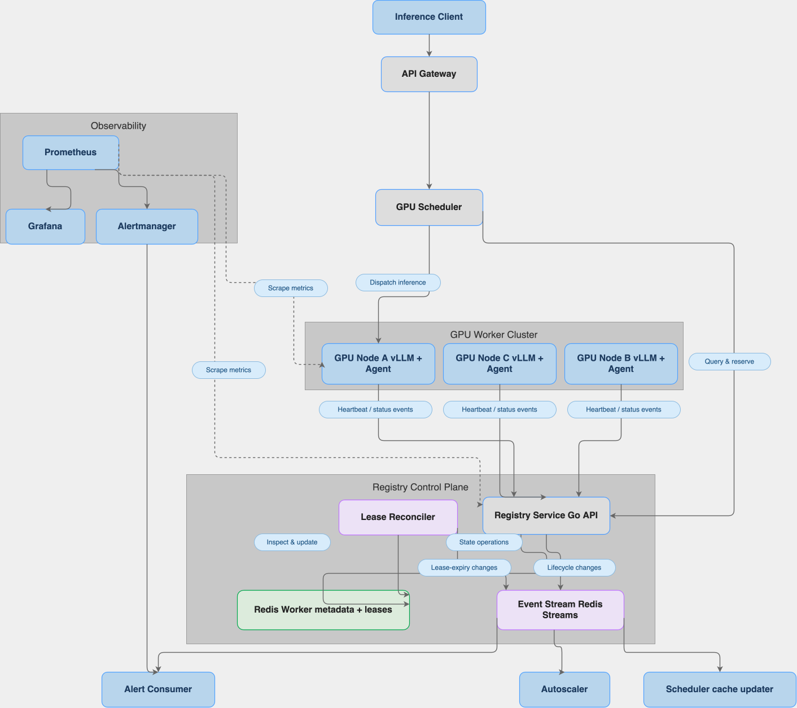

# Distributed GPU inference orchestrator

The connected prototype contains:

- `gateway`: selects a live worker from the registry and forwards inference.
- `agent`: a sidecar-ready health and load monitor, one per vLLM worker.
- `registry`: the Redis-backed worker registry and prototype scheduler.
- `inference-server`: the official vLLM container configured for CPU development
  and NVIDIA GPU production.

The project also includes a Redis-backed worker registry API at `registry`.
Agents populate it over HTTP with worker identity, vLLM endpoint, health,
queue depth, and KV-cache telemetry. Ten-second Redis leases remove workers
whose agents stop reporting. See
[`registry/README.md`](registry/README.md) for endpoints and local setup.

See [`inference-server/README.md`](inference-server/README.md) for setup and API
examples.

## Run the connected prototype

```bash
docker compose up --build
```

The first vLLM start downloads the configured model. Once the stack is healthy,
send inference through `http://localhost:8090/inference`. The gateway asks the
registry for a healthy, unexpired worker and routes the request to the endpoint
returned by the registry.


## System Architecture


